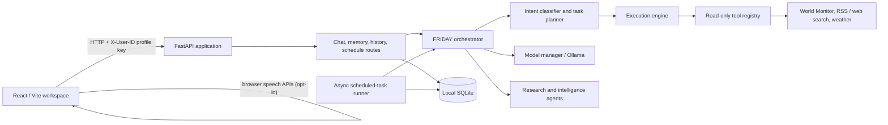

# Architecture and API reference

## System architecture

The browser sends chat requests to FastAPI. The orchestrator classifies intent, plans the request, executes read-only registered tools, and delegates research or intelligence synthesis to the relevant agent using the configured Ollama model. Execution traces include plan and tool status. External services can be unavailable; telemetry and research responses must retain their live/fallback and evidence limitations.

Conversation memory, explicit memories, execution history, and scheduled-task records use the local SQLite database. Memory and execution-history retention are separately opt-in. Scheduled prompts are explicitly user-created; task runs are stored to show results and failures. The browser polls for completion notices while open. The scheduler skips overdue runs instead of replaying them.

## Local API

Base URL: `http://127.0.0.1:8000`. Interactive OpenAPI documentation is available at `/docs` while the backend is running. Except for the endpoints marked public below, user-scoped endpoints require an `X-User-ID` header containing a UUID.

`X-User-ID` is a local profile partition key, **not authentication**. The app is designed for a trusted local machine and must not be exposed as a multi-user service without real authentication and authorization.

| Method and path | Purpose | User-scoped |
| --- | --- | --- |
| `GET /` | Application status and active model | No |
| `GET /api/health` | Backend and Ollama/model health | No |
| `POST /api/chat` | Run an assistant request; accepts `prompt`, optional conversation `history`, optional `session_id` | Optional profile |
| `GET /api/models` | List installed Ollama models | No |
| `POST /api/models/select` | Select an installed model (`model`) | No |
| `POST /api/models/benchmark` | Benchmark a model (`model`, optional `prompt`) | No |
| `GET /api/monitor/telemetry` | World Monitor live or labeled fallback telemetry | No |
| `GET /api/memory/settings` / `PUT` | Read or set `memory_enabled` | Yes |
| `GET /api/memory/sessions` | List saved conversations | Yes |
| `GET /api/memory/sessions/{session_id}` / `DELETE` | Read or delete a saved conversation | Yes |
| `GET /api/memory/items` / `POST` | List or save an explicit memory item | Yes |
| `DELETE /api/memory/items/{memory_id}` | Delete an explicit memory item | Yes |
| `GET /api/history/settings` / `PUT` | Read or set execution-history `enabled` | Yes |
| `GET /api/history?limit=20` | List recent execution records | Yes |
| `GET /api/history/{trace_id}` | Read an execution record | Yes |
| `PUT /api/history/{trace_id}/feedback` | Set feedback to `positive` or `negative` | Yes |
| `DELETE /api/history/{trace_id}` / `DELETE /api/history` | Delete one or all execution records | Yes |
| `GET /api/scheduled-tasks` | List recurring tasks | Yes |
| `POST /api/scheduled-tasks` | Create task with `title`, `prompt`, and `interval_minutes` | Yes |
| `POST /api/scheduled-tasks/{task_id}/pause` / `resume` | Pause or resume a task | Yes |
| `DELETE /api/scheduled-tasks/{task_id}` | Delete a task and its run history | Yes |
| `GET /api/scheduled-tasks/runs?limit=50` | List recent runs; optional `task_id` filter | Yes |

Chat prompts and prior messages are limited to 4,000 characters and 20 history items. Scheduled prompts are limited to 2,000 characters, titles to 120 characters, and intervals to 15–10,080 minutes. Memory content is limited to 2,000 characters. List limits are bounded by the API.

## Security and operations

- CORS origins come from `CORS_ORIGINS`, defaulting to the two local Vite origins; credentials are enabled, with methods limited to GET/POST/PUT/DELETE and headers limited to Content-Type/X-User-ID.
- `.env` is ignored by Git; `.env.example` contains configuration names and non-secret defaults only.
- Logs intentionally omit prompt and response content, endpoint credentials, and raw exception text. Error logs identify the exception type rather than storing arbitrary messages.
- Memory, history, and scheduler data are local and are not encrypted by the app. Do not store secrets in prompts, memory, or scheduled tasks.
- Browser speech recognition/synthesis is optional and handled by browser APIs; speech recognition support and data handling depend on the browser.
- Tool registry currently provides information retrieval only. Consequential actions require a separate approval mechanism before any such tool is added.

## Known limitations

- Profile UUID headers provide partitioning only; there is no user authentication or multi-tenant security boundary.
- Search results are snippets and metadata; FRIDAY does not retrieve the full text of every linked article.
- Static World Monitor fallback values are examples, not current measurements.
- Speech recognition is browser-dependent and was not validated against a physical microphone in the automated checks.
- Scheduled work runs only while the backend is running. A task overdue by more than one interval is marked missed; runs interrupted by shutdown are marked failed and are not automatically retried.
- The routing evaluator measures curated intent/tool-routing cases, not generated-answer factuality or live model quality.
- Live Ollama-backed research/intelligence quality depends on the local model and external service availability.
